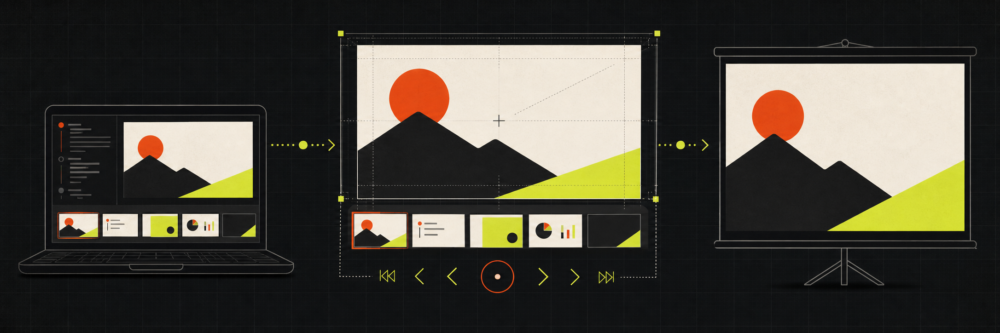

<p align="center">
  
</p>

<div align="center">

# Create HTML Deck

**把源材料变成可播放、可投屏、可验证的浏览器原生演示文稿**

不是把长文切成几页，而是让 Agent 完成叙事、设计、实现和真实设备检查

[](skills/create-html-deck/SKILL.md)
[](#交付契约)
[](LICENSE)

[**▶ 在线案例：别让一个线程从需求聊到代码写完**](https://verifiable-goal-weekly-share-public.pages.dev)

</div>

## 它解决什么问题

普通的 HTML 幻灯片很容易在外接显示器上看着正常，换到 14 英寸笔记本或投影时就出现裁切、滚动条、字号太小和控制按钮遮挡

`create-html-deck` 把这些要求固化成一个完整工作流：


## 适合什么场景

- 周会分享、项目复盘和技术演讲
- 浏览器里播放的 PPT / Slide Deck
- 需要在 MacBook 与 16:9 投影之间保持相同版式的演示
- 已有 HTML Deck 的改版、补页和响应式修复
- 需要把截图、架构图和产品证据组织成故事的分享

如果主要产物是 Landing page、交互原型或产品 Mockup，请使用 [`awesome-skills/design-artifact`](https://github.com/awesome-skills/design-artifact)

## 安装

```bash
npx skills@latest add awesome-skills/create-html-deck -g -y
```

然后直接描述材料和分享目标：

```text
Use $create-html-deck to turn these notes and screenshots into a 10-minute weekly-share deck
```

Skill 会优先读取现有笔记、截图、spec、handoff 和已有 Deck；材料已经回答的问题不会重新访谈

## 交付契约

默认产物包含：

- 固定 `1920×1080` 设计画布与视口等比缩放
- 方向键、Home、End、Page Up、Page Down 导航
- 可见的当前页 / 总页数
- 当前页 `localStorage` 持久化
- 可打印的全部页面
- 不小于 44px 的控制点击区域
- 相对路径图片资源和有意义的 `alt` 文本
- 无控制台错误、无页面滚动条、无视口裁切

新建 Deck 时可从 [`deck-template.html`](skills/create-html-deck/assets/deck-template.html) 开始；已有 Deck 会尽量保留原来的视觉语言

## 质量门

先运行便携结构检查：

```bash
python3 skills/create-html-deck/scripts/check_deck.py /absolute/path/to/deck.html
```

再用真实浏览器检查：

| 视口 | 用途 |
|---|---|
| `1512×982` | 14 英寸 MacBook 全屏 |
| `1512×850` | 14 英寸 MacBook 浏览器窗口 |
| `1366×768` | 常见小尺寸笔记本 |
| `1920×1080` | 标准投影与显示器 |

结构检查负责发现缺失画布契约、图片资源、重复 ID、缺失 `alt`、页码和导航问题；最终仍要通过截图确认换行、密度、图片裁切和视觉层级

## 仓库结构

```text
.
├── README.md
├── LICENSE
├── assets/create-html-deck-hero.png
└── skills/create-html-deck/
    ├── SKILL.md
    ├── agents/openai.yaml
    ├── assets/deck-template.html
    └── scripts/check_deck.py
```

## License

[MIT](LICENSE) · 收录于 [Awesome Skills](https://github.com/awesome-skills)
